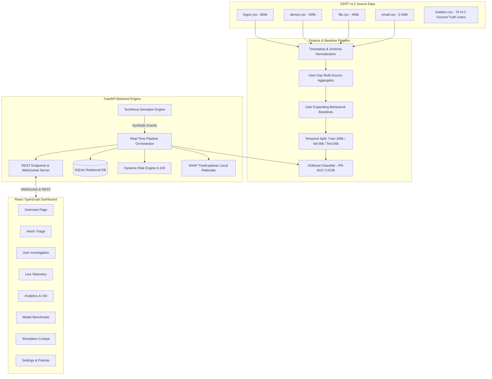

# System Architecture Specification

## 1. Architectural Overview

ThreatSight V2 is designed as a layered, defensive Security Operations Center (SOC) system structured across three core subsystems:

1. **Research & Modeling Pipeline (Offline)**: Processes CERT Release 4.2 raw logs (4.33M events), engineers multi-source features, learns historical user-specific expanding baselines, performs leakage-free temporal partitioning, and optimizes tree-based classifiers against PR-AUC and F1.
2. **FastAPI Detection Engine & Persistence Layer (Online)**: Ingests activity events in real-time, extracts 58-dimensional feature vectors against stored user baseline profiles, computes ML probability using XGBoost, evaluates a composite 0–100 Dynamic Risk Engine, runs local SHAP explanations, generates triage alerts, and persists records to SQLite (portable to PostgreSQL).
3. **React + TypeScript SOC Dashboard (Presentation)**: Provides a high-density, dark-mode cybersecurity interface across 8 operational pages with live WebSocket telemetry, user investigation drawers, and scenario simulation controls.



---

## 2. Dynamic Risk Scoring Formulation

The dynamic risk score $R(u, t) \in [0, 100]$ at time $t$ for user $u$ is computed as:

$$R(u, t) = \text{clip}\left(\left\lfloor P_{\text{ML}}(u, t) + D_{\text{Base}}(u, t) + H_{\text{Signals}}(u, t) \right\rceil, 0, 100\right)$$

Where:
1. **ML Probability Component** $P_{\text{ML}} \in [0, 45]$:
   $$P_{\text{ML}} = 45 \cdot \sqrt{\hat{p}_{\text{malicious}}}$$
2. **Behavioral Deviation Component** $D_{\text{Base}} \in [0, 25]$:
   $$D_{\text{Base}} = \min\left(25, 8.33 \cdot \max\left(0, \Delta_{\text{overall}}(u, t)\right)\right)$$
   Where $\Delta_{\text{overall}}$ is the mean standardized z-score deviation across logon hours, USB connects, file volume, and email traffic against user $u$'s historical expanding baseline.
3. **Cross-Source Heuristic Bonus** $H_{\text{Signals}} \in [0, 30]$:
   - $+20$ points for After-Hours Triple Signal (Logon + USB Connect + File Copy).
   - $+15$ points for After-Hours Device + File activity.
   - $+8$ points for High-volume file access ($\ge 15$ files).
   - $+10$ points for External email with attachments.
   - $+5$ points for Multi-PC hopping in a single session.

### Tier Cutoffs
- **0–29**: `LOW` (Routine enterprise activity, within expected parameters)
- **30–59**: `MEDIUM` (Minor deviations, single suspicious indicator)
- **60–79**: `HIGH` (Elevated anomalous behavior, SOC review recommended)
- **80–100**: `CRITICAL` (Multi-signal high-confidence data exfiltration threat)

---

## 3. Database Schema Design (SQLAlchemy)

The relational schema is configured in SQLite for zero-setup local execution while strictly adhering to SQL standards for seamless migration to PostgreSQL in enterprise production:

```text
Table: users
  - id (INTEGER, PK)
  - user_id (VARCHAR(64), UNIQUE, INDEX) -- e.g., 'ENG-014'
  - name (VARCHAR(128))
  - department (VARCHAR(64), INDEX)
  - role (VARCHAR(128))
  - email (VARCHAR(128))
  - assigned_pc (VARCHAR(64))
  - is_synthetic (BOOLEAN)
  - baseline_stats (TEXT - JSON)
  - created_at (DATETIME)

Table: activity_events
  - id (INTEGER, PK)
  - event_id (VARCHAR(64), UNIQUE, INDEX)
  - timestamp (DATETIME, INDEX)
  - user_id (VARCHAR(64), FK -> users.user_id, INDEX)
  - pc (VARCHAR(64))
  - activity_type (VARCHAR(64), INDEX) -- LOGIN, LOGOUT, DEVICE_CONNECT, etc.
  - details (TEXT - JSON)
  - is_after_hours (BOOLEAN)
  - is_weekend (BOOLEAN)
  - created_at (DATETIME)

Table: risk_scores
  - id (INTEGER, PK)
  - user_id (VARCHAR(64), FK -> users.user_id, UNIQUE, INDEX)
  - current_risk_score (INTEGER) -- 0 to 100
  - current_risk_tier (VARCHAR(32)) -- LOW, MEDIUM, HIGH, CRITICAL
  - ml_probability (FLOAT)
  - deviation_score (FLOAT)
  - heuristic_score (FLOAT)
  - top_factors (TEXT - JSON)
  - explanation (TEXT)
  - last_updated (DATETIME)

Table: risk_history
  - id (INTEGER, PK)
  - user_id (VARCHAR(64), FK -> users.user_id, INDEX)
  - timestamp (DATETIME, INDEX)
  - risk_score (INTEGER)
  - risk_tier (VARCHAR(32))
  - ml_probability (FLOAT)
  - trigger_event_id (VARCHAR(64))
  - details (TEXT - JSON)

Table: alerts
  - id (INTEGER, PK)
  - alert_id (VARCHAR(64), UNIQUE, INDEX)
  - timestamp (DATETIME, INDEX)
  - user_id (VARCHAR(64), FK -> users.user_id, INDEX)
  - risk_score (INTEGER)
  - risk_tier (VARCHAR(32))
  - behavior (VARCHAR(128))
  - primary_reason (TEXT)
  - status (VARCHAR(32), INDEX) -- NEW, ACKNOWLEDGED, RESOLVED
  - details (TEXT - JSON)
```

---

## 4. Explainable AI Architecture (SHAP)

For any feature vector $x \in \mathbb{R}^{58}$, the TreeExplainer decomposes the XGBoost log-odds prediction $f(x)$ into additive feature contributions $\phi_i$:

$$f(x) = \phi_0 + \sum_{i=1}^{58} \phi_i(x)$$

Where:
- $\phi_0$ is the expected background value across the training population.
- $\phi_i(x)$ is the exact Shapley attribution for feature $i$.
- Features with $\phi_i > 0.05$ increase risk; features with $\phi_i < -0.05$ act as mitigating baseline factors.
- The `explainability.py` module parses the top $K$ features by absolute magnitude $|\phi_i|$ and synthesizes structured natural language bullet points for SOC analysts.
